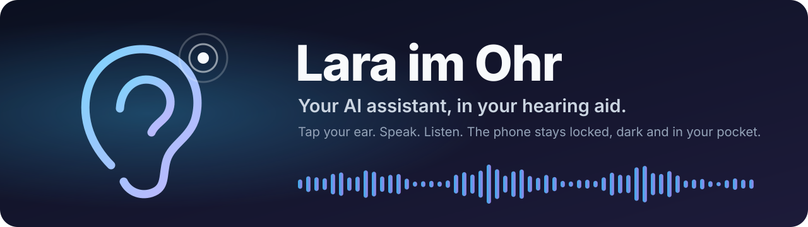
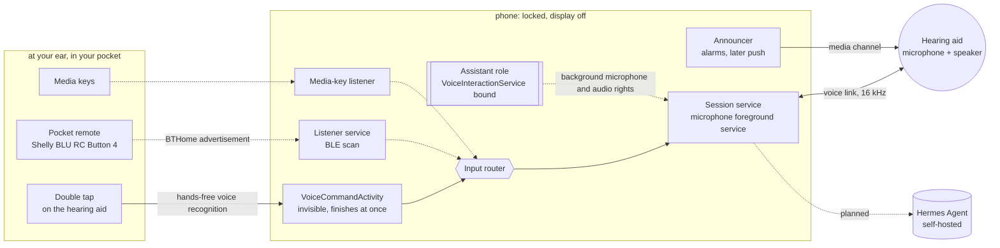
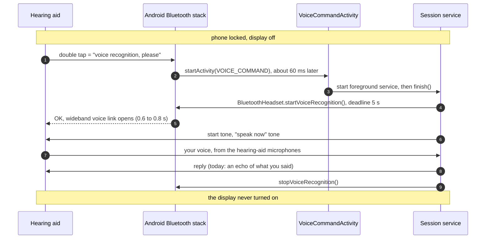

<p align="center">
  
</p>

<p align="center">
  <a href="https://github.com/Domi-cc/phonak-assistant/actions/workflows/ci.yml"></a>
  <a href="#where-it-stands"></a>
  
  
  
  <a href="LICENSE"></a>
</p>

<p align="center">
  <b>Tap your ear. Speak. Listen.</b><br>
  A personal AI assistant that lives in a hearing aid, while the phone stays locked, dark and in your pocket.
</p>

---

> [!IMPORTANT]
> **This is a measurement app, not a product.** It exists to find out what Android really allows
> with a locked phone and a hearing aid. Everything below is marked as either
> 📏 **measured on the device** or 📖 **read from the Android 17 source**. Nothing is guaranteed,
> and it has been tried on exactly one phone and one hearing aid.

## What is this?

*Lara* is a self-hosted AI assistant (a [Hermes Agent](https://github.com/NousResearch/hermes-agent)).
The goal of this project is to talk to her through a **hearing aid** and a small **pocket remote**:
hear the weather, step through appointments and to-dos, dictate a note, all without taking the phone
out, unlocking it or even lighting up its screen.

Before any of that can be built, four questions need an answer on real hardware:

1. Can a tap on the hearing aid start *our* app on a locked, dark phone?
2. Can the app then record from the **hearing-aid microphone** and speak into the aid?
3. Does a button press on a pocket remote arrive, even after hours of sleep?
4. Can the app say something on its own, at the right moment?

This repository is the app that answers them, and the notes on everything we learned on the way.

## Where it stands

| | What | State |
|---|---|---|
| ✅ | A sideloaded app can be chosen as Android's digital assistant and keeps the role across updates | 📏 measured |
| ✅ | A **double tap on the hearing aid starts the app while the phone is locked and the display is off**; the display stays off | 📏 measured |
| ✅ | The app opens the wideband voice link in about 0.6 to 0.8 s, records from the **hearing-aid microphone** and plays audio into the aid | 📏 measured |
| ✅ | The app can speak **unprompted** over the media channel, and only if the sound would reach the hearing aid and nothing else. An hourly test alarm fired from deep sleep 48 ms late | 📏 measured |
| ✅ | **Tap to wake, remote to navigate:** in a session opened by the tap, presses on the pocket remote are received with the phone dark and in Doze, and spoken into the aid ("Taste 1 kurz") | 📏 measured (21 presses, 1 lost) |
| 🧪 | The same after hours of idle, and with the phone in a pocket | not measured yet |
| 🔨 | The remote opening a session by itself (listening all day in the background) | built, not on the phone yet |
| 🗓 | Spoken menu, Hermes connection, media keys | planned |

<sub>All measurements: 27 November 2026, one device, small samples. Numbers and conditions: <a href="docs/measurements/2026-11-27.md">docs/measurements</a>.</sub>

### The eleven seconds that mattered

The first run with the phone **locked and dark**, as the app's own journal recorded it
(device name removed; `·dunkel ·gesperrt` is the app's German for *dark, locked*):

```text
16:15:31  tap_intent                           ·dunkel ·gesperrt
16:15:31  session_voice_recognition_requested  ·dunkel ·gesperrt   accepted=true  ms=8
16:15:31  session_link_up                      ·dunkel ·gesperrt   ms=744
16:15:33  session_speak_now                    ·dunkel ·gesperrt   ms=1830
16:15:37  session_recorded                     ·dunkel ·gesperrt   fromHearingAid=true  silenced=false  rmsDbfs=-21
16:15:41  session_echo_played                  ·dunkel ·gesperrt   ms=10395
16:15:42  session_end                          ·dunkel ·gesperrt   result=ok
```

Screen wake-ups during those eleven seconds: **zero**.

## How it works



<sub>Solid lines work today. Dashed lines are in progress or planned.</sub>

**What happens when you tap your ear:**



## What Android taught us

The plan we started with was wrong in several places. These are the things worth knowing before
you build something similar.

1. **The hearing-aid gesture does not go through the assistant role.** 📏
   Android's Bluetooth stack turns the hands-free "voice recognition" request into a plain
   `startActivity` with `android.intent.action.VOICE_COMMAND`. Whoever the owner picked as
   *Always* for that intent gets it. On a Pixel the Google app competes for it.
2. **Without a default handler, a tap on a locked phone goes nowhere.** 📏
   Android wants to show its app chooser, cannot, and closes it 40 ms later. No sound, no error.
3. **You still want the assistant role.** 📖
   Not for routing, but because the system keeps the selected `VoiceInteractionService` bound,
   and that binding is what lets a background trigger (a remote, an alarm) open the microphone.
   A battery-optimisation exemption alone does not.
4. **You have five seconds.** 📏
   The app must answer with `BluetoothHeadset.startVoiceRecognition()` within 5 s. A second tap
   during those 5 s is rejected by Android, and a tap during a running session ends it.
5. **Do not ask for the audio route yourself.** 📏
   Calling `AudioManager.setCommunicationDevice()` during a voice-recognition session makes the
   audio server open a "virtual call", and the Bluetooth stack reacts by cancelling the voice
   recognition. Our first build lost one tap in three to exactly this race.
6. **The voice link only lives while something is playing.** 📏
   It drops within tens of milliseconds once no stream is active. The app therefore keeps one
   `AudioTrack` running for the whole session and feeds it silence between sounds.
7. **`TextToSpeech.speak()` plays in the engine's process, not yours.** 📖
   Fine for an announcement over the media channel. For the voice link, synthesise to a file and
   play it yourself, or point 6 bites.
8. **Android 17 throttles background BLE scanning.** 📖 (effect on this phone not measured yet)
   Apps without visible UI get a per-hour allowance; after that the radio listens for 512 ms every
   10.24 s. A remote that advertises for one second per press is then caught about one time in
   seven. Expectation: fine for navigating *inside* a session, poor for waking the phone.
9. **Android 17 mutes background audio that lacks the right state.** 📖
   It does so silently. The phone's own log shows it muting other apps (`AudioHardening` lines in
   `dumpsys audio`).
10. **Google's own assistant gives up on a locked phone.** 📏
    It opens the voice link, waits about five seconds and closes it again.

## Rules the app keeps

- **Only one hearing aid, chosen by you.** Sessions and announcements go to the device you
  selected, identified by its address. Never to a car kit, another headset or the phone speaker.
  If the sound would go anywhere else, the app stays silent and writes down why.
- **The display stays off.** Nothing in the app asks for the screen.
- **The microphone opens only after a deliberate trigger.** There is no wake word and no
  always-on listening.
- **Other devices keep their voice button.** A voice-button press from a car or another headset is
  handed on to the phone's own assistant.
- **Failures are never silent.** A tone in the hearing aid, a vibration, and a line in the journal.

## Try it

> [!NOTE]
> There is no release yet. Until the first tagged build appears under *Releases*, build the APK
> yourself (see [Build from source](#build-from-source)). If you fork this, put your own
> signing key into your repository's secrets and let GitHub build signed APKs for you:
> [`docs/release.md`](docs/release.md).

**You need:** an Android 16+ phone (minSdk 36), a hearing aid or headset with a hands-free
"voice assistant" gesture, and `adb` for installing.

1. Install the APK: `adb install -r app/build/outputs/apk/debug/app-debug.apk`
2. Open **Lara im Ohr** and work down the checklist (the app's texts are German):
   - *Berechtigungen*: allow microphone, nearby devices and notifications.
   - *Assistentenrolle*: choose the app as digital assistant.
   - *Hörgerät*: pick which connected device is your hearing aid.
   - optional, *Shelly-Fernbedienung anlernen*: press a button on the remote and pick it.
3. With the phone **unlocked**, do the assistant gesture on the hearing aid once. Android shows a
   chooser: pick **Lara im Ohr** and **Always**.
4. Lock the phone, let the display go dark, and tap again.

Android drops the *Always* choice silently whenever another app that handles the same intent is
installed. The checklist line *Hörgeräte-Sprachtaste* shows who currently gets the tap.

### What you hear

| Sound | Meaning |
|---|---|
| Two rising tones | the session is open |
| One higher tone | speak now |
| One lower tone | recording finished |
| *your own voice* | the echo test plays back what the hearing-aid microphone recorded |
| "Taste 1 kurz" | a press on the remote arrived: button and gesture, spoken (a tone per button if the phrase is not ready yet) |
| "einer fehlt" | the remote's packet counter shows that a press was lost before this one |
| "Beende" | the session ends normally |
| Two falling tones | the session closed normally |
| Two low buzzes | something went wrong (in the hearing aid) |
| A short double vibration | something went wrong before the link to the hearing aid was up |
| One soft tone, then speech | an unprompted announcement |

### The journal

Every event is written to a journal with three clocks, screen and lock state, Doze state, battery
and whether the assistant binding is alive. It is on the app's screen and in logcat:

```bash
adb logcat -s LaraJournal
```

## Build from source

```bash
# JDK 21, Android SDK platform 37.2 and build-tools 36.0.0
./gradlew :core:test :app:assembleDebug
```

Pinned and verified on 27 November 2026: Gradle 9.9.2, Android Gradle Plugin 9.5.3, Kotlin 2.4.21,
compileSdk 37.2, minSdk 36, targetSdk 36 (switch with `-Plara.targetSdk=37`).

> [!WARNING]
> **Use one signing key for every build you ever install.** An update signed with a different key
> cannot replace the app, and uninstalling first loses the assistant role, the permissions and
> the *Always* choice. Put your keystore under `.local/keystore/` (ignored by git); see
> `app/build.gradle.kts` and [`docs/release.md`](docs/release.md).

**Layout**

| Path | What |
|---|---|
| `core/` | pure Kotlin, no Android imports: journal format, BTHome parser, press tracking with loss counting; 93 JVM tests |
| `app/…/trigger` | the invisible activity that receives the hearing-aid tap |
| `app/…/assistant` | the three services that make the app a digital assistant |
| `app/…/audio` | the voice link to the hearing aid, the session service, the echo test |
| `app/…/shelly` | the remote: search, live test, reception during a session, spoken presses |
| `app/…/speech` | spoken phrases, synthesised once and cached as audio for the voice link |
| `app/…/announce` | unprompted announcements and the hourly test |
| `docs/design/` | the design document for this version (German) |
| `docs/measurements/` | what was measured on the device, with conditions |
| `docs/research/` | the research and verification reports behind the design |
| `CLAUDE.md` | hand-over notes for continuing the work in an AI coding session |

<details>
<summary><b>Debugging toolkit</b>: the commands worth knowing</summary>

```bash
# Who is the assistant, and is its service bound?
adb shell cmd role get-role-holders android.app.role.ASSISTANT
adb shell dumpsys voiceinteraction | grep -m3 -E 'mComponent|mBound'

# Who gets the hearing-aid voice button right now?
adb shell cmd package resolve-activity --brief -a android.intent.action.VOICE_COMMAND -c android.intent.category.DEFAULT
adb shell cmd package query-activities --brief -a android.intent.action.VOICE_COMMAND

# Watch a tap arrive and the voice link come up
adb logcat -s HeadsetService HeadsetStateMachine HeadsetSystemInterface ActivityTaskManager AS.AudioDeviceBroker LaraJournal

# Bluetooth: bonded devices, profiles, scan clients; flags that change scan behaviour
adb shell dumpsys bluetooth_manager
adb shell device_config list bluetooth | grep -i scan

# Android 17 background-audio hardening: what was muted, and make violations loud while testing
adb shell dumpsys audio | grep -i hardening
adb shell cmd audio set-hardening throw

# Is the display really off, and who woke it?
adb shell dumpsys power | grep -E 'mWakefulness=|Waking up'
```

Wireless debugging is worth setting up early: a phone on a USB cable never reaches deep sleep, so
nothing measured on a cable says much about a phone in a pocket.

</details>

## Tested hardware

| | |
|---|---|
| Phone | Google Pixel 10 Pro XL, Android 17 (build `CP3A.261005.005`) |
| Hearing aid | Phonak Audéo EON R, right ear only, Bluetooth Classic (hands-free + media) |
| Remote | Shelly BLU RC Button 4 (`SBBT-004CUS`, the model *without* Zigbee) |

Nothing else has been tried. Other hearing aids that offer a "voice assistant" gesture over the
hands-free profile should behave the same on the Android side; whether they do is unknown.

## Related projects

This project stands on other people's work. If you wear hearing aids and want to build something
similar, start here. Every repository below was checked through the GitHub API on 27 November 2026.
Most are young projects by one author. Licences are listed because this code base is Apache-2.0:
projects marked **ideas only** are GPL or AGPL, so read them, but do not copy from them into
Apache-licensed code.

### A button on a hearing aid or headset starts an assistant

- [jooray/i-hear-you](https://github.com/jooray/i-hear-you) (MIT): Android remote for GN/ReSound hearing aids in which the aid's own button starts a voice note that is recorded through the aids, transcribed on the phone, sent to a webhook or an agent and answered with speech in the aids. It is the closest relative of this project, has a unit-tested gesture engine and a debug receiver that simulates every input over adb, and does not work with Phonak.
- [kerero/airdots-double-tap](https://github.com/kerero/airdots-double-tap) (MIT, last change 2023): the smallest example of the entry point used here, one invisible activity with an intent filter for `android.intent.action.VOICE_COMMAND` that catches the assistant gesture of Bluetooth earphones.

### The hearing-aid microphone on Android

- [jooray/android-bluetooth-microphone](https://github.com/jooray/android-bluetooth-microphone) (MIT): a written field guide to recording from Bluetooth headsets, LE Audio earbuds and hearing aids, including recording with the screen off and a debugging recipe, measured by its author on a Pixel 10 Pro Fold with Android 17.
- [jooray/third-ear](https://github.com/jooray/third-ear) (GPL-3.0, ideas only): a voice recorder that implements that guide, worth reading for how it decides when a Bluetooth microphone really delivers sound and for its crash-safe recording journal.
- [mptfire/bt-mic](https://github.com/mptfire/bt-mic) (MIT text with an added note, see its LICENSE file): a small implementation of the same guide that keeps its decision logic in pure state machines which are tested without Android.
- [thivyan-studios/hark-app](https://github.com/thivyan-studios/hark-app) (BSD-3-Clause): turns the phone into a remote microphone that streams to hearing aids and shows offline live captions; it shows how to keep track of hearing-aid audio devices and how to recover a stream after a route change.

### Phonak

- [ijustlikeit/phonak-ha](https://github.com/ijustlikeit/phonak-ha) (MIT): Phonak battery, volume, program and mute in Home Assistant through an Android bridge app. Its `PROTOCOL.md` is the only public description of the Sonova control protocol that our search turned up, and `tools/sonova_decode.py` shows how to decode the vendor app's traffic from a Bluetooth snoop log. It can switch the tap setting on and off but receives no tap events.
- [ryleighnewman/Self-Programming-My-Phonak-Hearing-Aids-With-Claude-AI](https://github.com/ryleighnewman/Self-Programming-My-Phonak-Hearing-Aids-With-Claude-AI) (MIT): a wearer's detailed account of adjusting Phonak Audéo Sphere hearing aids with the fitting software. Background reading, not medical advice.

### Shelly BLU and BTHome buttons on Android

- [OferTiber/SaraButton](https://github.com/OferTiber/SaraButton) (MIT): an accessibility app in which a press on a Shelly BLU remote places a phone call. It supports the remote model used here and shows background reception with two scans at once, a callback scan and a `PendingIntent` scan.
- [altinojoao/bthome-bridge](https://github.com/altinojoao/bthome-bridge) (MIT licence file, but the README reserves all rights, so treat it as ideas only until that is cleared up): forwards BTHome button presses to HTTP with the screen off, worth reading for how it renews and watches its scans and for BTHome decryption in Kotlin. The README is in Portuguese.
- [steanlab/BTHome-Logger](https://github.com/steanlab/BTHome-Logger) (MIT): shows unencrypted BTHome data live on the phone, the quickest way to see what a remote really sends.
- [Bluetooth-Devices/bthome-ble](https://github.com/Bluetooth-Devices/bthome-ble) (MIT) and [home-assistant/bthome.io](https://github.com/home-assistant/bthome.io) (no licence file): the reference parser that Home Assistant uses, and the source of the format specification. The parser's tests make good test vectors for a parser of your own.
- [ALLTERCO/shelly-script-examples](https://github.com/ALLTERCO/shelly-script-examples) (Apache-2.0): the vendor's own scripts, among them its BTHome parsing for Shelly BLU devices (`ble/ble-shelly-blu.shelly.js`).
- [theengs/decoder](https://github.com/theengs/decoder) (GPL-3.0, ideas only): a decoder library with a device description and test packets for Shelly's four-button remotes.

### Hermes clients that take the Android assistant role

- [Codename-11/hermes-relay](https://github.com/Codename-11/hermes-relay) (MIT): native client with chat, hands-free voice and an optional assistant role that also starts from the lock screen. Its [issue 774](https://github.com/Codename-11/hermes-relay/issues/774) reports the same finding as ours: a Bluetooth assistant gesture bypasses the default assistant and arrives as `VOICE_COMMAND`.
- [Hy4ri/hermes-mobile](https://github.com/Hy4ri/hermes-mobile) (Apache-2.0): native Compose client under the same licence as this project. It talks to Hermes over the REST API and the WebSocket gateway and declares a `VoiceInteractionService`.
- [JusticeFist/alfatherapp](https://github.com/JusticeFist/alfatherapp) (MIT): phone and Wear OS client whose assistant part is small enough to read in one sitting. It starts a live call from the assistant session and selects a headset with `setCommunicationDevice`.
- [Giton22/kyllene](https://github.com/Giton22/kyllene) (MIT): phone and Wear OS client, both with a `VoiceInteractionService`. It exposes spoken replies as a media session, so that play and pause buttons control them.
- [yuga-hashimoto/openclaw-assistant](https://github.com/yuga-hashimoto/openclaw-assistant) (MIT): voice client for OpenClaw and Hermes with wake word and assistant role. Its README documents the settings for talking to the Hermes API server.

### Home Assistant's Assist, the mature reference for the role

- [home-assistant/android](https://github.com/home-assistant/android) (Apache-2.0): the most mature open app that can be the default assistant, with a start from the lock screen, a microphone foreground service and an activity alias for `VOICE_COMMAND`. Its [issue 7834](https://github.com/home-assistant/android/issues/7834) documents on a Pixel with Android 17 that the voice gesture of a Bluetooth headset does not go to the selected assistant.
- [majorminorlabs/hermes-voice](https://github.com/majorminorlabs/hermes-voice) (MIT): connects a Hermes profile to Home Assistant Assist, a way to talk to Hermes through an existing assistant app without writing one.

### Hermes Agent and other clients

- [NousResearch/hermes-agent](https://github.com/NousResearch/hermes-agent) (MIT): the agent itself. Its gateway code is the authority for the HTTP interface that clients use.
- [chezgoulet/hermes-vox](https://github.com/chezgoulet/hermes-vox) (GPL-3.0, ideas only): voice-first client with speech processing on the device. Read `docs/ASSISTANT-ROLE.md` for a plain account of what the assistant role does and does not do, and its notes on routing audio to a Bluetooth headset.
- [virse/HermiVoiceApp](https://github.com/virse/HermiVoiceApp) (Apache-2.0): sideloaded push-to-talk app with German and English offline speech recognition through sherpa-onnx. Its README is German first.

### Starting a voice session on a locked phone

- [suddenBook/GPTWake](https://github.com/suddenBook/GPTWake) (the LICENSE file holds an Apache-2.0 notice): starts a voice session from a wake word on a locked tablet with the screen off. Its README has a table of Android constraints measured on a real device, among them that the app had to stay the default assistant to get the microphone under the lock screen.
- [NiallBunting/AssistantVoiceRecorder](https://github.com/NiallBunting/AssistantVoiceRecorder) (GPL-3.0, ideas only): about the smallest complete example of a selected assistant that starts a microphone recording in a foreground service.
- [DicioTeam/dicio-android](https://github.com/DicioTeam/dicio-android) (GPL-3.0, ideas only): offline voice assistant that takes the assistant slot with an activity for `ASSIST` and `VOICE_COMMAND` instead of a `VoiceInteractionService`, which shows the other way to become an assistant.

### A spoken menu without a screen

- [Scottish-Tech-Army/Soundscape-Android](https://github.com/Scottish-Tech-Army/Soundscape-Android) (MIT, see its `LICENSE.md` for the files from other sources): audio navigation for blind people with a spoken, hierarchical menu that is operated with the media buttons of a headset (`AudioMenu.kt`). It is the model for the menu planned here.

### Other remotes, and building your own

- [zmkfirmware/zmk](https://github.com/zmkfirmware/zmk) (MIT) with [Genteure/zmk-bthome](https://github.com/Genteure/zmk-bthome) (MIT): keyboard firmware and a module that adds BTHome advertisements, a starting point for a home-made remote that sends both media keys and BTHome button events.
- [50ButtonsEach/flic2lib-android](https://github.com/50ButtonsEach/flic2lib-android) (its own permissive licence, see `License.txt`): the official Android library for Flic 2 buttons, which hold a connection instead of advertising. Its README says what the vendor recommends for running in the background.

### Speech on the device

- [k2-fsa/sherpa-onnx](https://github.com/k2-fsa/sherpa-onnx) (Apache-2.0): speech recognition, speech synthesis, voice activity detection and keyword spotting that run on the phone, with ready Android example apps.
- [ggml-org/whisper.cpp](https://github.com/ggml-org/whisper.cpp) (MIT) and [snakers4/silero-vad](https://github.com/snakers4/silero-vad) (MIT): Whisper speech recognition in C and C++ with Android examples, and a small model that tells speech from silence.

### More for people who wear hearing aids

The streaming projects in this group use ASHA or LE Audio. The hearing aid used here streams over Bluetooth Classic, so they are listed for readers with other hearing aids.

- [Gheop/hearing-aid-presets](https://github.com/Gheop/hearing-aid-presets) (MIT): switches the programs of LE Audio hearing aids from the GNOME desktop through the standard Hearing Access Service, with thorough set-up notes for Linux. Tested by its author on ReSound.
- [thewierdnut/asha_pipewire_sink](https://github.com/thewierdnut/asha_pipewire_sink) (Unlicense): streams audio from Linux to ASHA hearing aids, with a frank account of the state of ASHA on Linux.
- [shermp/Pico-ASHA](https://github.com/shermp/Pico-ASHA) (BSD-3-Clause for the source): a USB audio dongle built from a Raspberry Pi Pico W that streams from any computer to ASHA hearing aids, with a table of hearing aids that work.
- [Tympan/Tympan_Library](https://github.com/Tympan/Tympan_Library) (MIT) and [HoerTech-gGmbH/openMHA](https://github.com/HoerTech-gGmbH/openMHA) (AGPL-3.0, ideas only): an open hardware platform for hearing aids and an open research platform for hearing-aid signal processing, for readers who want to go below the Bluetooth layer.
- [rscircus/awesome-hearing](https://github.com/rscircus/awesome-hearing) (MIT): a list of further projects around hearing aids.

### Testing, debugging, updating

- [google/bumble](https://github.com/google/bumble) (Apache-2.0): a Bluetooth stack in Python that, with a USB dongle, can play a hands-free headset, a hearing aid or an advertising button (`examples/run_hfp_handsfree.py`, `examples/run_advertiser.py`), so that code on the phone can be tried without the real hardware.
- [mauricelam/btsnoop-extcap](https://github.com/mauricelam/btsnoop-extcap) (MIT): shows the phone's Bluetooth traffic live in Wireshark over adb.
- [ImranR98/Obtainium](https://github.com/ImranR98/Obtainium) (GPL-3.0, ideas only as far as its code goes): installs and updates sideloaded apps straight from their GitHub release pages.

## Roadmap

- [x] Assistant role, hearing-aid tap, voice link, echo test
- [x] Unprompted announcements, hourly test
- [x] Pocket remote: BTHome parsing, search and live test, spoken presses inside a session
- [ ] Pocket remote: listening in the background, so that a press can open a session
- [ ] Measurements: after hours of idle, in the pocket, per scan mode
- [ ] Media keys as an extra trigger
- [ ] Spoken menu: weather, appointments, to-dos
- [ ] Hermes connection, speech recognition, reminders pushed from the agent
- [x] Signed builds from CI (any branch on demand, releases for tags)
- [ ] First release

## Licence

[Apache-2.0](LICENSE).

This is a private project. It is not affiliated with, endorsed by or supported by Sonova or
Phonak, Shelly, Google or Nous Research. It is not a medical device, and it does not change
anything about how a hearing aid amplifies sound.
